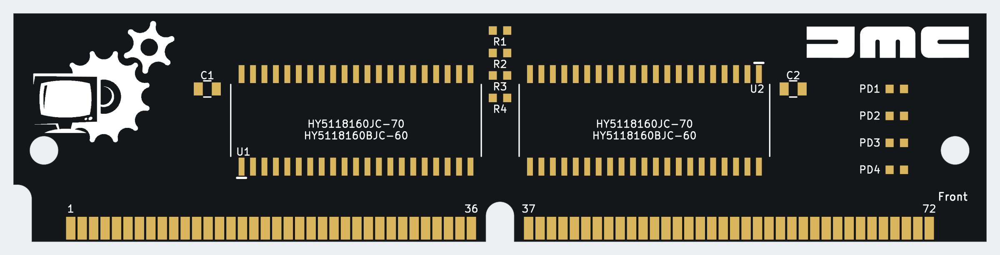
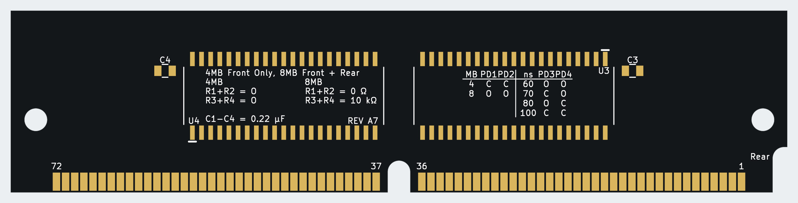

# Amiga 72-pin FPM SIMM

A common PCB for **4 MB single-sided** and **8 MB double-sided** 5 V FPM SIMMs, developed for Amiga 4000 motherboard memory configurations. Current revision: **A7**.

The project began with a wish to make RAM that visually matches Re-Amiga systems: **black PCB, white silkscreen and gold contacts and exposed pads**. It is a collaboration between **Paul of UK Computing Limited**, **Jon of JMC Electronics** and **AI assistance through Codex**.

**Routed CAD draft. No physical prototype has been tested. The included Gerbers are for review, not an approved manufacturing release.**

**Status, 19 October 2026:** donor components have been ordered, and the PCB order has been submitted. The PCB is awaiting the manufacturer's engineering verification and approval before manufacture. Assembly and hardware testing are still to follow.




These are unpopulated CAD appearance previews: black solder mask, white silkscreen and gold exposed pads. Actual colours and contact plating are fabrication choices.

## PCB and files

Open [HY8M-SIMM.kicad_pro](HY8M-SIMM.kicad_pro) with **KiCad 10.0 or newer**. Project-local symbols and footprints are included.

| Property | Current design |
|---|---|
| Connector | 72-pin SIMM, 32-bit non-parity |
| Outline | 107.95 × 25.4 mm |
| Finished thickness | 1.2 mm proposed; stack-up not approved |
| Copper layers | **Four** |
| F.Cu | Front signals and pads |
| In1.Cu | GND plane |
| In2.Cu | Signals and +5 V copper fill |
| B.Cu | Rear signals and pads |
| Minimum signal track / nominal clearance | 0.20 / 0.20 mm |
| Through vias | 0.60 mm copper diameter / 0.30 mm drill |

In2.Cu is a mixed signal/supply layer. The design does not have separate GND and power planes on this four-layer PCB.

## 70 ns assembly options

Both builds use **HY5118160JC-70** DRAMs and the same PCB. DNP means do not populate.

| Build | DRAM population | Capacitors fitted | R1/R2 | R3/R4 | PD links fitted |
|---|---|---|---|---|---|
| [4 MB / 70 ns](variants/4MB-70ns/BOM.csv) | U1/U2, front only | C1/C2 | DNP | DNP | PD1, PD2, PD3 |
| [8 MB / 70 ns](variants/8MB-70ns/BOM.csv) | U1–U4, both faces | C1–C4 | 0 Ω each | 10 kΩ each | PD3 |

Capacitors are **220 nF (0.22 µF), 0805, X7R, 16 V or higher**. Use new capacitors. Links and pull-ups use 0603 pads. PD4 remains open in both builds.

Separate [60 ns variants](assembly-options.csv) are retained for the verified **HY5118160BJC-60** part. Use the chosen variant's BOM and DNP-marked schematic. Fitting different PD links cannot make a 70 ns chip operate as a 60 ns part.

A true 4 MB single-sided build omits U3/U4, C3/C4 and R1–R4. Disabling the rear rank of a physically double-sided board does not make it a single-sided module for socket clearance.

## Intended Amiga configurations

| Purpose | Intended population |
|---|---|
| 2 MB Chip RAM | One fully populated 8 MB module; intended to use 2 MB and leave 6 MB unaddressed |
| 16 MB Fast RAM | Two 8 MB modules in Fast slots 1 and 3 |
| 16 MB Fast RAM | Four front-only 4 MB modules in Fast slots 1–4 |

Fast-slot numbering excludes the separate Chip RAM socket. These configurations are based on A4000 host-wiring research and **remain untested on hardware**. The Chip RAM experiment uses the four-chip 8 MB assembly. See [compatibility research](docs/compatibility-research.md) for sources and motherboard-revision details.

## Donor chips

The Hyundai HY5118160 devices were chosen for their relatively low SOJ package profile and the availability of suitable donor SIMMs on online marketplaces during project planning. This made them a practical starting point for the matching modules while keeping one chip family across the 4 MB and 8 MB builds.

Obtain readable photographs of **every fitted chip on both faces** before buying a donor. The specified 70 ns device is **HY5118160JC-70**: 5 V, 1M×16, FPM, 42-pin 400 mil SOJ, 1K refresh. The separately verified 60 ns alternative is **HY5118160BJC-60**.

An “8 MB / 2M×32 / 72-pin” listing or bare PCB number does not identify its chips. **HY5118164 is EDO**, and **HY5116160B has a different refresh organisation**; neither is the specified donor. Confirm the complete marking and datasheet rather than relying on similar part numbers.

Test the intact donor before desoldering and record orientation/pin 1. One healthy four-chip donor can supply one 8 MB board or two 4 MB boards, assuming all devices survive removal. This project does not certify donor authenticity, seller stock or recovered-chip health.

## Fabrication issues still open

- **Finger setback:** the 144 contact pads have **0.2286 mm** clearance to the outline. [PCBWay's published gold-finger guidance](https://www.pcbway.com/pcb_prototype/PCB_Gold_fingers.html) specifies **0.5 mm minimum**. The present geometry needs a manufacturer-approved resolution before manufacture.
- **Bevel:** a **45° bevel is unresolved**, not an approved order setting. Agree the actual contact/bevel geometry and processing method for this 25.4 mm-high module; see [PCBWay's bevel guidance](https://www.pcbway.com/helpcenter/Engineering_Questions/The_requirement_of_beveling_on_gold_finger_area.html).
- Confirm the proposed 1.2 mm finished stack-up, SOJ land pattern, socket/case fit and wear-resistant hard-gold contact process. Generic ENIG is not a substitute for an agreed finger-plating specification.

The retaining holes are closed circular Edge.Cuts profiles, not duplicate NPTH drill hits. Use the [four-layer file map](docs/layer-file-map.txt) and read [fabrication notes](fabrication-review/READ-BEFORE-ORDERING.txt). The common paste layers include all footprints; assembly/stencil use must follow the chosen BOM.

## Checks and limitations

The saved design has **864 track segments, 195 vias and zero unconnected items**. The [exact copper comparison](docs/copper-comparison.txt) confirms unchanged routing, pads, component placements, outline and filled copper between A3–A6, the user-edited PCB and A7. The independent mapping review passes 321 assertions.

**144 contact-edge errors and 46 schematic-parity warnings remain documented.** Existing project settings ignore seven check types; no ERC report is included. Read [validation.txt](docs/validation.txt) and the [native DRC report](docs/drc-routed.json) for the scope and remaining findings. CAD checks do not establish timing, refresh, signal integrity or operation in an Amiga.

Run the portable preservation audit from the repository root:

```sh
python3 source/compare_copper.py
```

The current silkscreen preserves the manually edited layout, with UK Computing artwork on the front left and JMC on the front right. Rear assembly notes and PD tables sit beneath the rear chip bodies. Historical generator scripts can overwrite custom artwork; use the [development workflow](source/WORKFLOW.md).

## Project contents

| Path | Purpose |
|---|---|
| [BOM.csv](BOM.csv), [assembly-options.csv](assembly-options.csv) | Population comparison |
| [variants/](variants/) | Four assembly BOMs and DNP-marked schematics |
| [previews/](previews/) | Native layer plots, schematic and appearance views |
| [fabrication-review/](fabrication-review/) | Draft Gerbers, drills and fabrication notes |
| [docs/](docs/) | Pin map, research and validation reports |
| [source/](source/) | Artwork baseline, reference PCB and development/verification tools |
| [Assembly guide](docs/ASSEMBLY.md) | 70 ns parts, fitting and system quantities |
| [Component ordering](docs/COMPONENT-ORDERING.md) | DigiKey parts and quantities for either ten single-sided or ten double-sided modules, with spares |
| [Fabrication options](docs/FABRICATION-OPTIONS.md) | Quotation selections and open bevel review |
| [PCB ordering screenshots](docs/FABRICATION-OPTIONS.md#ordering-screenshot-reminders) | PCBWay settings, hard-gold thickness and selective-finish reminders |
| [Project history](docs/PROJECT-HISTORY.md) | A1–A7 development record |
| [NOTICE.md](NOTICE.md) | Template attribution and supplied artwork |

## Attribution

Project collaboration: **Paul, UK Computing Limited; Jon, JMC Electronics; and AI assistance through Codex**. The collaborators ask that the UK Computing and JMC artwork remains in its existing positions on shared versions and manufactured boards derived from this design, with the project and template credits retained. See [attribution and supplied artwork](NOTICE.md).

The mechanical starting point is [wiretap-retro/72-pin-SIMM-KiCAD-Template](https://github.com/wiretap-retro/72-pin-SIMM-KiCAD-Template). Its original [template README](source/template-README.md) and [PCB template](source/template.kicad_pcb) are retained. Circuit/package facts come from Hyundai documentation; host behaviour and PD codes are sourced in [compatibility research](docs/compatibility-research.md).

This project is not a measured clone of PCB P1004B746400 / B7464 Rev.A.
