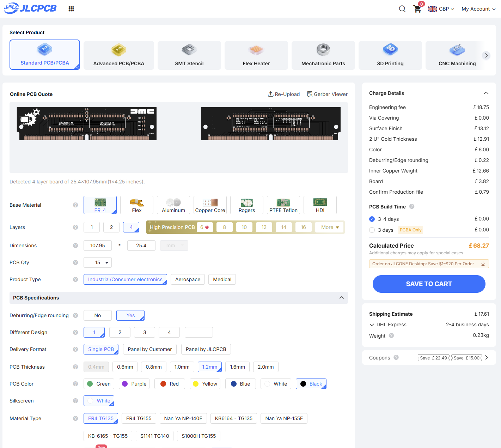
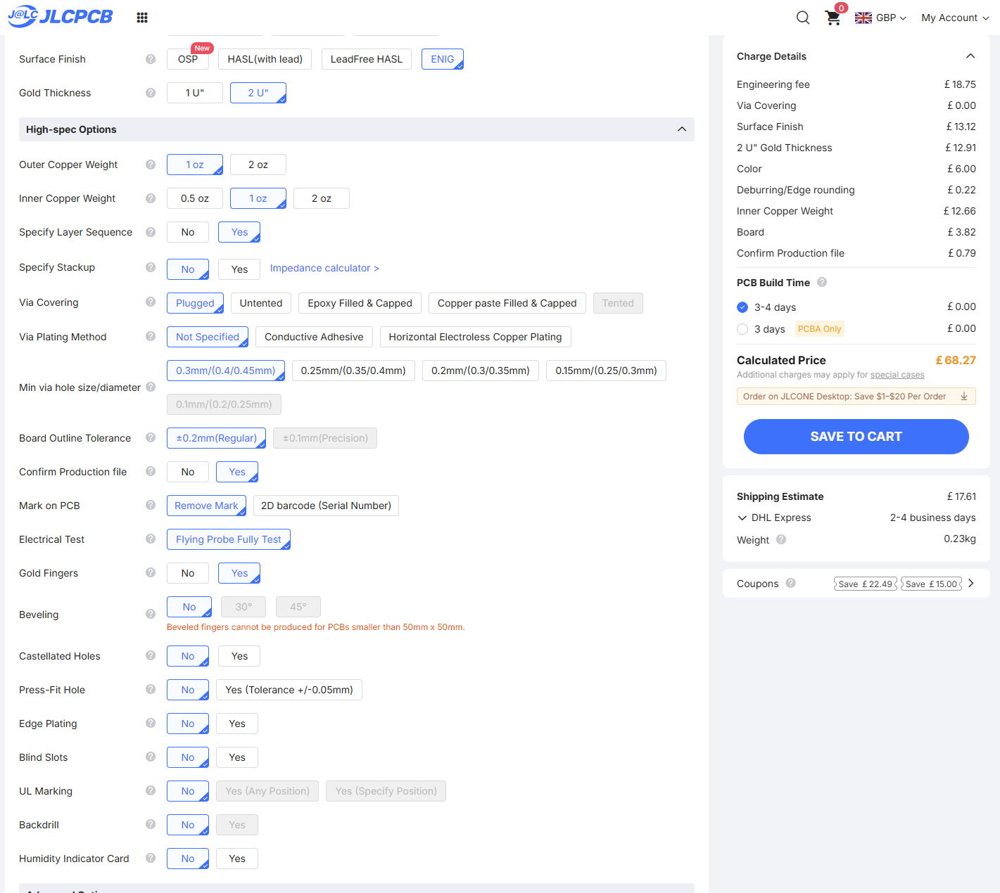
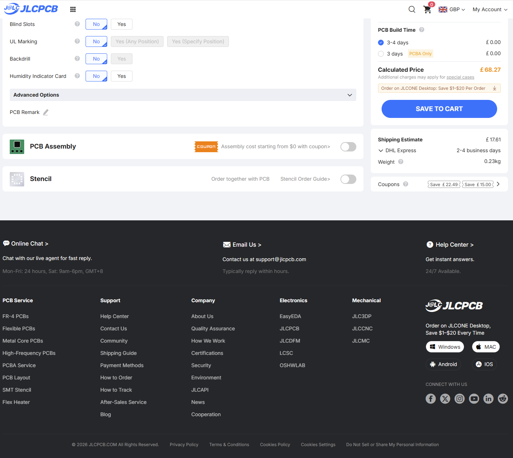
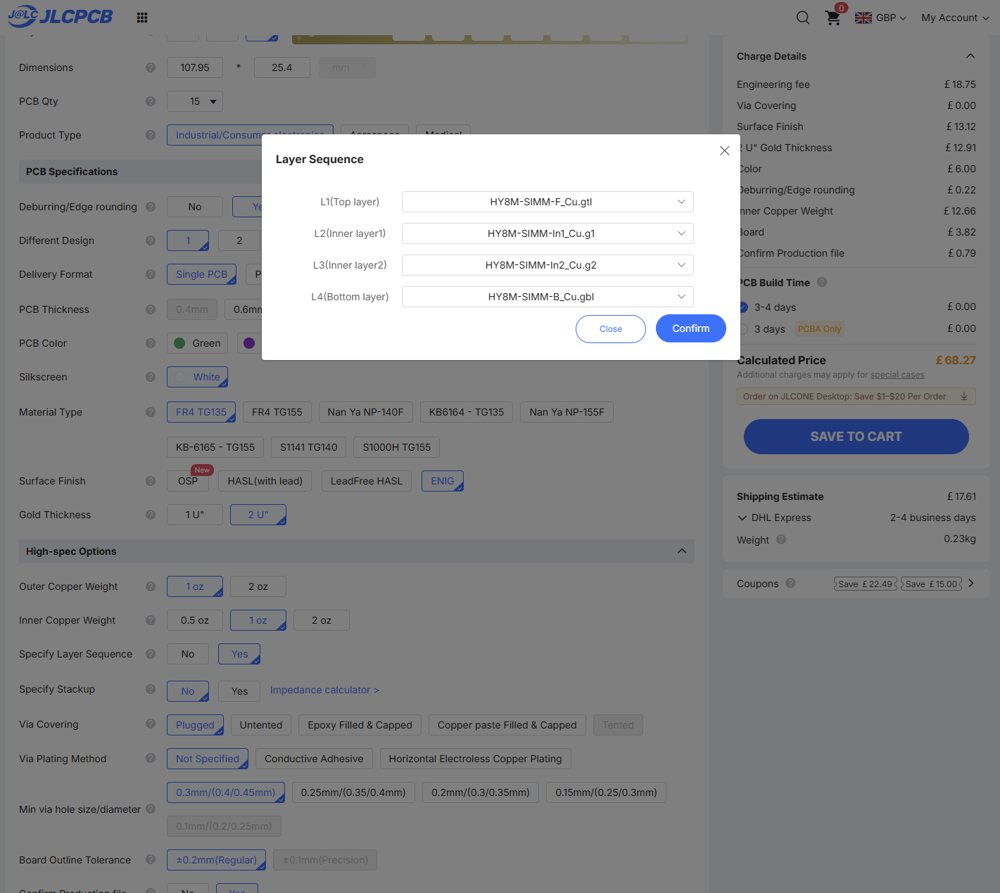
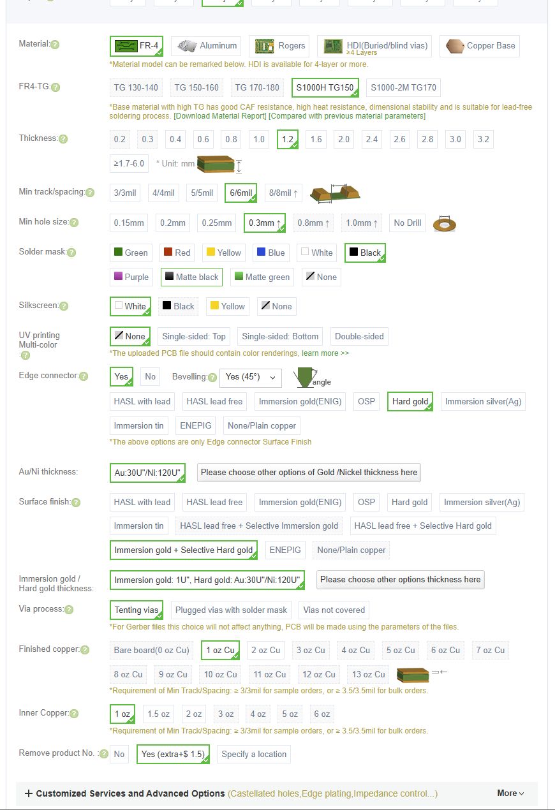
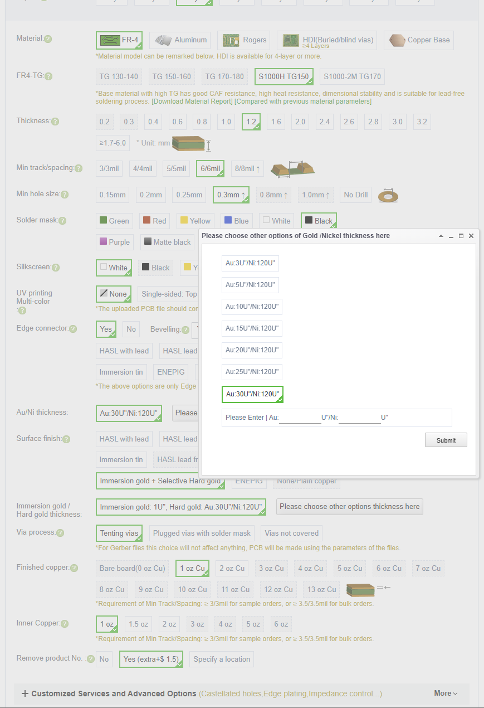
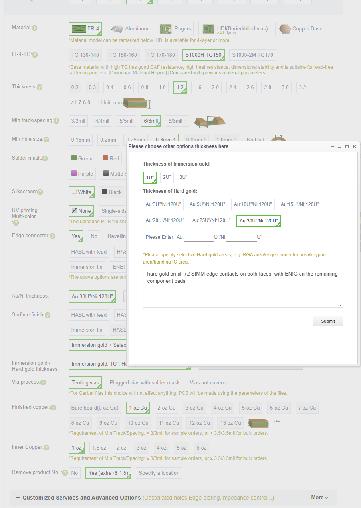

# Fabrication options and ordering record

## Current JLCPCB prototype order, 20 October 2026

The first **15-board** order was placed with JLCPCB after the PCBWay quotation
was too expensive. The processed production archive has been reviewed against
the original A7 exports, with **no functional connection change or correction
blocking prototype manufacture found**. The requested production-file
confirmation accounted for the order's “1 item Requires Action” notice.

**Status update, 21 October 2026:** Paul reported that the donor RAM is in
transit and the 15 new JLCPCB PCBs are in manufacture. See the
[production review](JLCPCB-PRODUCTION-REVIEW.md) for the exact package hash and
scope. Assembly, socket fit and Amiga hardware testing remain pending.

| Parameter | Selected JLCPCB option |
|---|---|
| Product / delivery | Standard PCB, 15 individual boards, one design |
| Outline / layers | 107.95 × 25.4 mm / four |
| Material | FR-4 TG135 |
| Finished thickness | 1.2 mm nominal; no custom dielectric stack-up specified |
| Copper | 1 oz outer and 1 oz inner |
| Solder mask / silkscreen | Black / white |
| Surface finish | ENIG, 2 microinch gold selected |
| Layer sequence | Specified explicitly; see table below |
| Via covering | Plugged with solder-mask ink |
| Via plating method | Not specified |
| Minimum via setting | 0.30 mm drill category; design uses 0.60 mm copper diameter |
| Board outline tolerance | ±0.2 mm regular |
| Production-file confirmation | Yes |
| Mark on PCB | Remove mark |
| Electrical test | Flying probe fully test |
| Gold fingers | Yes |
| Bevelling | No |
| Deburring / edge rounding | Yes |
| Edge plating | No |
| Castellated / press-fit / blind slots | No |
| UL mark / backdrill / humidity card | No |
| PCB assembly / stencil | Not selected; manual assembly planned |

The **Gold Fingers** selection does not specify electroplated hard gold.
This batch uses ENIG on exposed pads and contacts, replacing the earlier
selective hard-gold proposal. ENIG was accepted as the prototype finish;
hard gold offers better wear resistance for repeated insertion. JLCPCB's
[finish explanation](https://jlcpcb.com/blog/hard-gold-pcb-finish) describes its
ENIG service and states that electroplated hard gold is not offered.

**Edge Plating must stay No:** it means metal on the routed board edge and is
separate from the flat SIMM contact fingers. An early quotation selected this
unnecessarily; the final screenshots below show it corrected.

### Contact geometry and finished-board checks

The 25.4 mm board height falls below JLCPCB's published 50 × 50 mm minimum for
bevelling, and the order selects **No bevel**. This records the chosen batch
process, not a claim that every SIMM/socket combination can use an unbevelled
edge. JLCPCB also publishes a general 50 mm gold-finger size statement, so
future orders should obtain engineering acceptance for this short outline.
See [JLCPCB's gold-finger guidance](https://jlcpcb.com/help/article/jlcpcb-gold-fingers).

The native finger setback is **0.2286 mm**. Reviewed copper compensation leaves
approximately **0.221 mm**; all contacts and functional connections remain.
The original 144 DRC findings against the generic 0.50 mm rule stay documented.
The production review is specific to this returned archive; review any new CAM
package again rather than assuming another fabricator will process it the same way.

Measure finished connector thickness and inspect edge quality before insertion.
The [published ±10% thickness tolerance](https://jlcpcb.com/capabilities/pcb-capabilities/) would span 1.08–1.32 mm around
1.2 mm; fit in the actual socket remains unverified. Do not force the board.
If manually removing a small FR-4 burr, preserve the plated contact faces.
There is little spare setback for a substantial hand-cut bevel.

The reviewed CAM confirms the nominal thickness, copper weights, colours,
ENIG, plugged vias and no bevel. The selected 2 microinch gold thickness and
deburring are order requirements shown in the screenshots; CAM artwork does
not certify actual plating thickness, deburring quality or finished tolerances.
The retaining holes are **3.18 mm finished non-plated**, with 3.25 mm compensated
drill tools in the production data.

### JLCPCB ordering screenshots

These capture the final quotation selections supplied on **20 October 2026**.
Displayed prices, delivery estimates and available options are historical;
they are not a current quotation or the final paid invoice.

## Historical PCBWay quotation, 19 October 2026

The remainder records the earlier PCBWay quotation, not the current JLCPCB order.
These are the PCBWay quotation selections discussed on 19 October 2026.
As of that date, donor components have been ordered and the PCB order has been
submitted. The PCB is awaiting the manufacturer's engineering verification and
approval before manufacture. The settings below record the intended order
specification; manufacturer approval is still outstanding. No price or delivery
date is guaranteed by these files.

| Parameter | Selected/intended option |
|---|---|
| Supply form | Individual boards; quote quantity ten |
| Copper layers | Four |
| Actual outline | 107.95 x 25.4 mm; quoting interface rounds length to 108 mm |
| Material | FR-4, S1000H TG150 |
| Finished thickness | Proposed 1.2 mm, tolerance/socket fit to be confirmed |
| Track/spacing capability | 6/6 mil, covering the saved 0.20 mm geometry |
| Minimum drilled hole | 0.30 mm |
| Solder mask | Black |
| Silkscreen | White |
| UV colour printing | None |
| Edge connector | Yes; selective hard gold on contacts on both faces |
| Hard-gold plating | Au 30 microinch over Ni 120 microinch |
| Remaining component pads | ENIG, immersion gold 1 microinch |
| Via covering | Tented according to the Gerber mask data |
| Outer/inner copper | 1 oz /1 oz |
| Manufacturer product number | Omit from PCB |
| Stencil/assembly service | Not selected; manual assembly planned |

The hard-gold area is all 72 SIMM edge contacts on each face. The component
pads use ENIG. Gold/nickel thickness fields in both the edge-connector and
combined-finish selections should agree. These process requirements are not
encoded by the Gerber artwork alone.

## Ordering screenshot reminders

These screenshots were supplied on **19 October 2026** to record the PCBWay
order selections. Use them alongside the settings above and the four-layer
file map below. Manufacturer engineering approval of the contact/bevel
geometry and finished stack-up is still outstanding.

### Main order settings

Black solder mask, white silkscreen, 1.2 mm finished thickness, 6/6 mil
capability, 0.30 mm minimum drill and 1 oz outer/inner copper. **Remove product
No.: Yes** means the manufacturer's product number should be omitted.
The pictured **45-degree bevel remains subject to engineering approval**.

### Gold-finger plating

The edge-connector selection is hard gold, **Au 30 microinch over Ni
120 microinch**. This should agree with the selective-finish setting below.

### Selective finish and plating note

The combined finish is **immersion gold plus selective hard gold**:
1 microinch immersion gold on the component pads, with Au 30 microinch over
Ni 120 microinch hard gold on the SIMM fingers. The screenshot records this
note for the manufacturer:

> hard gold on all 72 SIMM edge contacts on both faces, with ENIG on the remaining component pads

## Physical layer order

| Layer | Gerber |
|---|---|
| L1, front | HY8M-SIMM-F_Cu.gtl |
| L2, GND | HY8M-SIMM-In1_Cu.g1 |
| L3, signals/+5 V fill | HY8M-SIMM-In2_Cu.g2 |
| L4, rear | HY8M-SIMM-B_Cu.gbl |

Only current A7 exports are included. Obsolete A6 inner-layer duplicates were
removed. See [layer-file-map.txt](layer-file-map.txt) and the Gerber job file.

## Bevel and contact-edge review remains open

The quotation selects a 45-degree bevel, but the native design does not define
its depth, remaining tip thickness or machining tolerance. The contact copper
starts 0.2286 mm from the insertion edge; PCBWay's published gold-finger guide
specifies a minimum 0.5 mm setback. This requires explicit engineering
acceptance or a design change before manufacture.

Ask PCBWay to confirm the finished mating thickness and tolerance; the bevel
cross-section on both faces; whether it intersects the existing fingers; the
remaining usable plated contact length; inner-layer copper clearance; and how
the 25.4 mm board height and key notch will be handled during bevelling.

For a symmetrical ideal 45-degree bevel on a 1.2 mm board, keeping the bevel
entirely before the 0.2286 mm copper setback would require at least 0.7428 mm
remaining tip thickness. This is a geometric observation, not an approved
socket or machining specification.

PCBWay's published ordinary-process guidance flags boards below 45 mm in the
dimension perpendicular to the connector edge. Their engineering team must
confirm an appropriate panel or fixture process for this outline.

References:

- [PCBWay gold-finger guide](https://www.pcbway.com/pcb_prototype/PCB_Gold_fingers.html)
- [PCBWay edge-connector order guidance](https://www.pcbway.com/helpcenter/ordering_parameter_instruction/Edge_Connector.html)
- [PCBWay bevelling requirements](https://www.pcbway.com/helpcenter/Engineering_Questions/The_requirement_of_beveling_on_gold_finger_area.html)

The 144 documented copper-edge DRC errors remain in the supplied reports.
No assembled-board operation, timing, refresh or Amiga compatibility test has
been completed. Read [validation.txt](validation.txt) and
[the fabrication notes](../fabrication-review/READ-BEFORE-ORDERING.txt).
